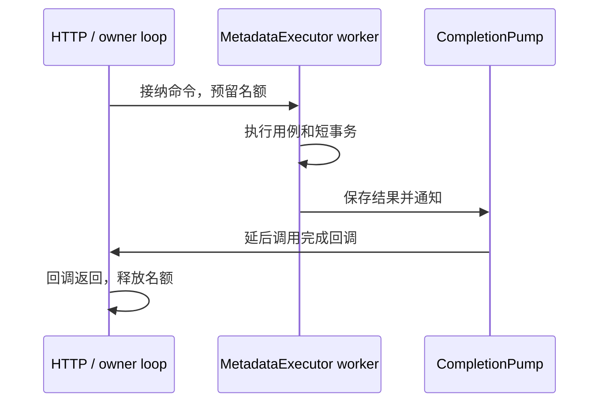

# 调度、恢复与服务生命周期

runtime 的主要工作是安排业务在哪个线程执行，以及在请求结束后把资源收好。HTTP 回调在所属事件循环上运行；数据库、密码和文件操作交给各自的工作线程。本文中的 owner loop 指拥有执行器的事件循环，“完成处理”包含结果回调返回和相关资源释放，而不只是 worker 算出了结果。

## 从请求到完成回调

以创建目录为例：HTTP 层构造类型化命令，提交给 [MetadataExecutor](MetadataExecutor.h)。执行器在接纳时预留任务和完成存储，元数据线程调用应用用例并提交事务，再通过 [CompletionPump](CompletionPump.h) 通知事件循环。事件循环消费结果、调用 HTTP 层提供的回调，然后归还任务名额。

同步拒绝不会再回调；接纳后会在所属 loop 延后完成一次，包括取消的任务。回调应短小，不阻塞 loop，也不能在回调内销毁执行器。HTTP 状态通过弱引用访问，以免请求已经结束而任务仍持有它。

[TaskDispatcher](../application/ports/TaskDispatcher.h) 是接入层看到的接口，不包含 muduox 或数据库类型。内部 `submitOperation` 供 runtime 组合阶段使用，不开放为 HTTP 任意提交闭包的入口。

## 元数据线程与容量

`MetadataExecutor` 在 owner loop 构造，`start(factory, started, stopped)` 只接受一次启动。工厂在 worker 上创建 Store、Clock、ID 生成器及所需身份资源，资源也在同一个线程销毁。不要在 loop 上打开数据库，再通过闭包把连接转交给 worker。

空工厂、重复启动或线程创建失败同步返回错误。启动接纳后，资源缺失或工厂异常通过异步启动结果报告，并完成停止清理。`started` 成功只说明元数据资源可用，整个 HTTP 服务还没有就绪。

设 `maxPending=Q`，默认 Q 为 256；`drainBatch` 默认 32，范围为 1～32。待执行队列最多 Q 项，所有尚未释放的任务合计最多 Q+1 项。后一个计数包括排队、运行、等待回调以及正在回调中的任务，因此取消请求或清空待执行队列都不能提前归还名额。回调重入提交也受此限制。

两个环形队列在构造时分配，完成队列有 Q+1 个位置。完成发布移动已有任务与结果，不再扩容业务存储。执行器限制任务数量，调用者仍须控制输入和闭包大小。

未就绪或已停止的提交返回 `Stopping`；队列满返回 `QueueFull`。空回调、序号耗尽或接纳前分配失败返回 `InternalError`。任务 ID 只是执行器内部关联号，与请求 ID、节点 ID 不同，不能拿它作为幂等键。

### 取消与异常

`TaskHandle` 可以移动，也可以比执行器活得更久；销毁句柄不会取消任务。`cancelBeforeStart()` 可跨线程调用，与 Queued → Running 原子竞争：

| 结果 | 调用者应如何理解 |
| --- | --- |
| `Cancelled` | 不再执行该排队任务，但条目和完成回调仍需处理 |
| `AlreadyRunning` | 工作已开始，事务照常完成，不能据此判断回滚 |
| `AlreadyTerminal` | 已有终态，不表示完成回调一定已经消费 |

应用正常返回的错误保持原分类。无法确定写入效果的执行异常映射为 `CommitOutcomeUnknown`，保留创建目录的 attempt 信息，不自动重试。任务和外部回调异常分别计数，回调异常也不会触发第二次完成。可通过 `snapshot()` 查看队列和异常计数。

## 完成通知为何需要定时器

CompletionPump 合并多次通知，通常只保留一个待执行的 `queueInLoop` 回调，每轮消费至多配置的批量，剩余结果留到下一轮。消费结束检查与通知标志使用同一同步边界，避免刚检查到空队列就丢失新通知。

`queueInLoop` 的分配可能失败，已经接纳的结果不能因此丢弃。Pump 在构造时注册 10 ms 恢复定时器，投递失败时由定时器继续消费。启动、停止和线程退出使用固定控制状态，不占业务槽位。`postFailures()` 记录投递异常。

定时器也检查线程退出 future。worker 先销毁资源，真正退出后 future 才就绪；loop 看到就绪再 join，不等待仍在运行的线程。线程退出通知的登记若分配失败，会在执行资源工厂前拒绝启动。10 ms 是轮询周期，不是实时保证；loop 自身被阻塞时无法按时执行。

测试注入的 Post 必须线程安全、延后执行，且抛异常表示未接纳回调。不能改为可能内联执行的 `runInLoop`。Pump 内部 drain/idle 不得抛异常，外部业务回调由执行器隔离。

## 启动一个实例

[InstanceServer](InstanceServer.h) 在基础调度库之上装配 HTTP、密码、SQLite 和文件资源，持有 `PreparedInstance` 中的实例锁。基础 [AnofRuntime](AnofRuntime.h) 只协调元数据与外部 HTTP 的生命周期，不自行创建服务器、锁或配置。

启动顺序如下：

1. `prepareInstance` 取得排他锁、读取和校验配置、执行实例维护检查。
2. InstanceServer 创建元数据、密码和磁盘资源，完成上传恢复、已有 DELETING 对象的处理和最终对账。
3. 使用 muduox `DeferredListen` 构造服务器，在 owner loop 调用 `tryStart()`。
4. 监听成功后报告 ready 和实际端口。端口配置为 0 时返回系统分配的端口。

配置允许 `127.0.0.1` 或 `::1` 回环监听。开发 HTTP 模式不允许 Web、Origin 或可信代理配置；HTTPS 代理模式要求规范的 Origin 和可信回环代理。队列最多 256、HTTP 在途请求最多 128，HTTP 停止宽限为 0～30 秒。配置由 InstanceServer 传给 HttpApi，Cookie/Bearer 共用 worker 和停止流程。

构造 InstanceServer 不绑定端口。接纳启动后只通知一次 ready；初始化期间停止以 `Retryable` 报告取消。ready 回调抛异常会请求停止，停止回调异常计入 `notificationExceptions()`。对象不能重启。

监听错误中，地址占用映射为 `Conflict`，权限不足为 `Forbidden`，临时资源不足或系统调用中断为 `Retryable`，其余为 `InternalError`。服务不自动改端口或重试；监听失败也要等待 worker 和完成回调清理，再报告 Stopped。

## 停止顺序和锁的寿命

停止先关闭业务与维护准入，再请求 HTTP 停止。在 HTTP 宽限期内，保留上传协调器供既有请求继续 feed/finish；HTTP 清理结束后，取消剩余传输并等待文件操作和句柄关闭。没有启动 HTTP 的失败路径直接进入清理。

维护、上传和下载的阶段全部结束后才能停止磁盘；身份任务与密码线程也需退出。之后停止元数据，等全部 worker 退出和完成回调消费完，再结束 loop。InstanceServer 在自身回调栈之外析构，实例锁最后释放。仅观察到 `Stopped` 状态还不意味着实例锁已经释放。

MetadataExecutor 停止时将尚未运行的任务标为取消，正在运行的工作正常结束。它在完成名额归还、线程退出 future 就绪且 Pump 没有待执行通知后 join。析构不会替调用者阻塞等待或 detach；没有先停止便销毁活跃执行器会触发 fail-fast。

使用基础 AnofRuntime 时，调用者还需在实际 HTTP 启动后调用 `markHttpStarted()`，在真实停止回调中调用 `markHttpStopped()`。这两个方法只接收通知，不独立核实服务器状态。HTTP 和元数据先后结束均可，两个条件都满足才报告最终停止。

## 身份与密码任务

[IdentityExecutor](IdentityExecutor.h) 借用已经就绪的 MetadataExecutor。登录和改密先读取资料、关闭快照，再交给单独的密码线程计算，最后回到元数据线程复核并提交。注册先计算哈希，再提交邀请消费和账户创建。不存在的账户也执行 dummy 验证。

最多 8 个密码工作流、128 个身份任务，计数一直保留到完成回调释放；构造选项只能收紧这些限制。密码线程一次使用一个 64 MiB 工作区。取消可以阻止进入最终事务，但不会强行终止正在计算的哈希或已经开始的事务。旧密码验证失败不计算新哈希，秘密输入用完后销毁。

[AuthenticationLimiter](AuthenticationLimiter.h) 使用单调时间维护令牌桶：

| 范围 | 突发量 | 持续速率 |
| --- | --- | --- |
| 全局 | 16 | 每分钟 30 次 |
| 来源地址 | 5 | 每分钟 10 次 |
| 来源与规范登录名 | 3 | 每分钟 5 次 |

来源由可信入口提供，IPv4 统一为 mapped IPv6。最多保存 1024 条来源及组合记录，闲置 10 分钟后回收，满表拒绝新条目。登录/注册在接纳前限流；改密先鉴权并取得真实登录名，再在 owner loop 限流，因此可能以已接纳任务的完成结果返回 `RateLimited`。HTTP 中速率拒绝为 429，队列满为 503，会话数量达到上限为 409。

登录与注册最终阶段前，按需至多每分钟清理一次失效会话，每次最多 200 条；没有空闲周期清理，改密也不触发该清理。业务事务与会话规则见[身份用例](../application/identity/README.md)。

## 文件线程与传输

[DiskExecutor](DiskExecutor.h) 固定使用两个线程，各自创建和销毁文件 Store。任务绑定通道，文件句柄和哈希状态不能换线程。默认普通待执行队列为 256、清理队列为 8，加上两项运行任务，最多保留 266 项未消费工作。普通任务不能占清理预留槽。接纳的文件任务仍要执行并交付结果，停止后也不跳过清理。

[UploadExecutor](UploadExecutor.h) 在 owner loop 安排元数据和磁盘阶段。控制命令最多 128 项；PATCH 和下载共用全局 4 条、每用户 2 条流名额。每条流最多一个 64 KiB 块和一个在途操作，名额一直保留到同步、元数据确认、取消后的尾部处理和句柄关闭完成。

PATCH 的 `feed` 接纳后移交缓冲，拒绝时仍归调用者；前一个 feed 完成后才可继续，`finish` 只接受已收齐声明长度的流。120 秒没有实际进展会取消生产，但仍等待已运行任务结束。

哈希校验同时最多一条，逐块读取，其余 VERIFYING 记录等待扫描调度。通道 0 处理 PATCH 和文件维护，通道 1 处理哈希。未知 PATCH 提交需重开 Store 读取偏移，已经确认的数据不能截断；发布未知则结合持久意图、文件位置、长度和摘要判断，无法确认的上传冻结到重启恢复。

每 60 秒扫描至多 64 项活动上传和 64 项待清理上传，后者保留续页游标；终态保留清理每批最多 100 项。账户禁用在事务中写取消标志和新的 generation，提交后通知促使协调器读取它；重新启用账户不会复活上传。

### 下载的读取资格

下载先取得元数据授权，再通过 [BlobAccessRegistry](BlobAccessRegistry.h) 取得共享读资格，重新检查权限和内容关联，最后打开文件核对类型与长度。HEAD 不占流名额，但同样受命令和磁盘队列限制，且必须关闭文件后才返回；GET 返回下载流。

每次 `pull` 最多返回一个 64 KiB 块。HTTP writer 接纳多少字节，就通过 `consumed` 确认多少；上一块没有全部确认前不能继续 pull。零字节不刷新无进展期限。`blobPinned()` 只供观察，内容删除仍要取得注册表的排他资格。

取消回调在 owner loop 调用；注册时若流已经取消，可以同步调用，因此回调必须幂等并弱引用请求状态。请求结束或流析构只发起停止，读资格要保持到文件在所属通道关闭并消费完成结果。已授权下载不随登出结束，但确认禁用账户会取消它；未知禁用先重新核对账户状态。

## 启动恢复与后台清理

上传恢复先核对账本，再枚举内容目录检查归属和已发布对象的类型、长度，最后处理上传记录：

| 状态 | 恢复行为 |
| --- | --- |
| CREATING | 补齐安全的空暂存文件 |
| OPEN | 截断未确认尾部，文件短于确认前缀时拒绝启动 |
| VERIFYING | 重新排队校验 |
| READY | 核对摘要，保留目标，等待明确完成请求 |
| COMMITTING | 核对源/目标位置与完整摘要，继续发布并补目录同步 |
| 终态且待清理 | 删除文件、同步目录，再确认释放预留 |

未知文件保留原样并阻止启动。AVAILABLE 对象缺失属于完整性错误；DELETING 可以已经缺失，由删除恢复补同步和结算。登记的 UNAVAILABLE 对象要求损坏证据未变化，隔离文件必须对应 HELD 记录并与账本一致。未完成离线维护也会阻止在线启动。启动检查不重新哈希所有正常内容，完整摘要检查由 Full FSCK 完成。

[MaintenanceExecutor](MaintenanceExecutor.h) 复用元数据和磁盘线程，每 60 秒最多处理 16 条到期回收站、16 条 DELETING 重试和 16 个新清理候选。只运行一条内容删除链，各阶段让出 loop；队列满则延后，不积累 tick。

删除取得排他资格后，先标记 DELETING，再 `removeAndSync`，最后用新事务删除记录并释放物理计费。文件已经不存在也要同步父目录。未知提交通过新连接确认；无法判断时保留对该内容的封锁并暂停维护，重启后恢复。新到期条目和新清理候选不必在监听前全部清完。

[DriveExecutor](DriveExecutor.h) 同样复用元数据队列和线程，默认最多 128 项任务直到完成回调结束。读异常返回 `InternalError`，写异常保守返回 `CommitOutcomeUnknown`；不增加独立线程或等待队列。

## 离线装配与诊断

[InstanceInitialization](InstanceInitialization.h) 装配初始化所需文件、数据库和密码资源，不创建 HTTP 或 EventLoop。预算、额度和节点账本同事务引导，磁盘余量写入配置；schema/format 均为 5。文件发布完成前保留 pending。`finish` 验证已有引导后完成发布，不重设密码或创建身份。

[InstancePasswordPolicy](InstancePasswordPolicy.h) 统一新建与验证策略：Argon2id v19，65536 KiB、2 次迭代、parallelism=1；验证上限相同。测试使用的小参数不能改变生产装配策略。

[InstanceMaintenance](InstanceMaintenance.h) 在离线调用线程装配 FSCK、备份、恢复和密码重置。[OfflineRecovery](OfflineRecovery.h) 只处理指定上传或 DELETING 动作，复用应用事务，不启动 HTTP、周期维护或无关扫描；事务结束后才做文件工作。

[LogSink](LogSink.h) 使用 1024 个 4096 字节槽位和一个消费者。生产者不阻塞，满队列或竞争超限时丢弃诊断并计数；停止时先停止生产者，最多等待两秒刷出，再报告丢弃并等待线程退出。借用的输出 fd 必须活得更久，销毁时恢复其原标志。普通文件底层 I/O 卡住不受管道的非阻塞保证保护。

服务日志使用静态路由模板和固定分类，不记录原始 URL、头、正文或异常文本。muduox 自由文本替换为脱敏事件；日志失败只输出固定计数，避免递归记录。

[AuditRetentionExecutor](AuditRetentionExecutor.h) 每 60 秒提交一项元数据任务，按原始 UTC 和保留期清理审计，各表共用批次预算。另用短事务清理达到 90 天、且无文件责任的已完成维护记录。队列满延后，提交未知暂停；停止仍等待任务完成后才关闭元数据。

## 阅读测试与排查问题

- [Runtime_unittest.cc](tests/Runtime_unittest.cc)：队列、回调重入、取消竞争、投递失败和线程退出。
- [InstanceServer_unittest.cc](../../tests/integration/InstanceServer_unittest.cc)、[ServeProcess_unittest.cc](../../tests/integration/ServeProcess_unittest.cc)：真实服务启动、端口冲突、信号停止与锁释放。
- [IdentityExecutor_unittest.cc](../../tests/integration/IdentityExecutor_unittest.cc)：密码计算期间的并发修改、限流和取消。
- [UploadExecutor_unittest.cc](../../tests/integration/UploadExecutor_unittest.cc)、[DownloadExecutor_unittest.cc](../../tests/integration/DownloadExecutor_unittest.cc)：实际小文件传输、持久状态恢复与资格释放。
- [HttpDownload_unittest.cc](../../tests/integration/HttpDownload_unittest.cc)、[Maintenance_unittest.cc](../../tests/integration/Maintenance_unittest.cc)：HTTP 写背压、账户禁用及内容读删互斥。

这些测试区分组件替身、真实实例和子进程故障。实际 write WouldBlock 有覆盖，start/finish WouldBlock 和生产期限的自然超时并未由此建立。运行入口见[测试说明](../../tests/README.md)，关停及时间问题可启用[诊断工具](../../tests/diagnostics/README.md)。
