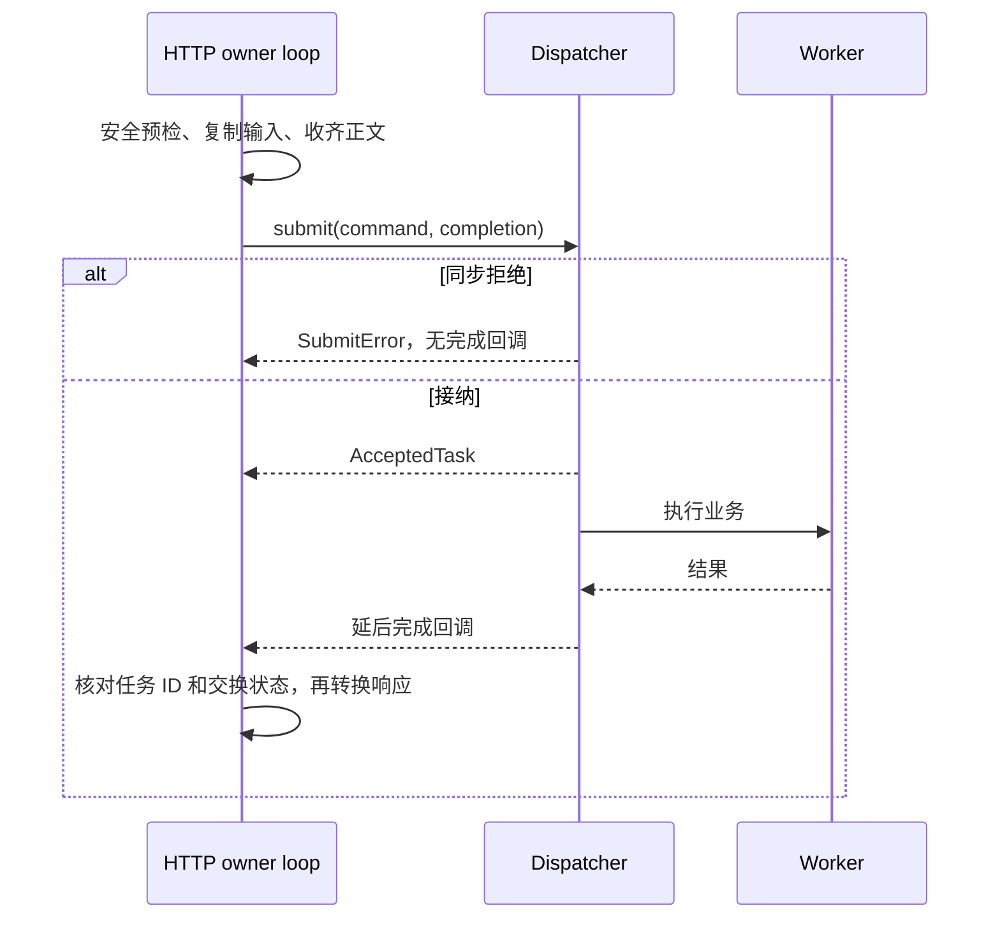

# 请求与流的生命周期

HTTP 收到完整请求时，业务工作往往还没结束。接入层把阻塞任务交给 dispatcher，保留发送响应所需的有限状态，然后让事件循环继续处理其他连接。本文沿着接纳、执行、发送和取消说明所有权；请求格式见 [HTTP 协议](WIRE.md)，服务装配见 [README](README.md)。

## 从选择路由到接纳任务

选择器在 HTTP 所属事件循环上同步运行，只做来源、凭据格式、路径、查询和头部检查，不访问数据库、磁盘或密码算法。路由参数、query 和正文都是借用；需要在异步阶段使用的内容，必须先转换为自有命令、条件值或有限头部副本。

多数控制操作使用 [makeIdentityStream](IdentityStream.h)，它接收 dispatcher、自有 RequestId 或 RequestContext、正文种类、parser、formatter、ready 回调和错误映射函数。每次进入流式回调都会建立一份 [AsyncRequestState](internal/AsyncRequestState.h)。收齐请求后，状态拒绝 trailer，再检查 ready，解析正文并最多提交一次任务。

同步拒绝没有完成回调。接纳后保存 TaskHandle，dispatcher 必须在所属 loop 延后恰好完成一次，不能在 submit 内同步回调。完成时先核对任务 ID 和 writer 是否仍活动，再调用 formatter。`mapError` 只处理已接纳任务的业务错误，同步提交拒绝保持公共映射。格式转换不负责事务或重试。

完成闭包只弱引用 HTTP 状态，不持有 writer。若请求已经结束，迟到结果直接销毁，不再格式化成功结果，尤其不能序列化迟到的登录 token。错误任务 ID 会中止交换；重复完成不会生成第二份响应。接纳后抛异常且不给句柄属于 dispatcher 违约，HTTP 无法补建取消和完成关系。

创建目录使用独立 [CreateDirectoryHandler](CreateDirectoryHandler.cc)，以保留 `CreateDirectoryAttempt` 事务诊断。它同样只提交一次，并将 request ID、task ID、可选 attempt、取消／错误及交付时 HTTP 是否活动传给 `DirectoryTaskObserver`。观测异常不会改变业务结果。

## 收体与秘密缓冲

公共异步桥接的 JSON 请求使用固定 64 KiB 容量的 [ExchangeBuffer](internal/ExchangeBuffer.h)，避免扩容留下旧正文副本；无正文模式不分配正文空间。解析／提交返回、拒绝、取消和析构时清理所持正文。命令中的密码等值继续由只移动的秘密类型拥有，不能保存指向原请求的视图。

JSON 响应先检查 512 KiB 上限，再复制到自有固定缓冲并清零临时正文。producer 每次最多取 writer 允许的 64 KiB，取出的区间立即清零，取消时清理剩余部分。[HttpStreamSender](../../../third_party/muduox/muduox/net/router/HttpStreamSender.h) 负责部分接纳、WouldBlock 和 writable 恢复；请求状态保留 sender 到结束或取消。

这些清理只覆盖 transport 管理的存储，不能保证 JSON lexer、sender、连接或内核中的所有副本被擦除。Bearer 登录和邀请创建只把秘密写入最终成功正文；Cookie 登录把秘密写入最终 Set-Cookie。其清除响应策略与构造失败限制见[安全说明](SECURITY.md#哪些响应清除-cookie)。

## 上传如何暂停输入

[UploadStream](UploadStream.cc) 用 prepare → feed → finish 串起一次 PATCH。prepare 异步检查身份、偏移和写资格；完成前 body 回调返回 0，表示暂时不能消费输入。成功取得流后才调用 resumeBody。收到 100 Continue 只代表可以继续发送正文，不代表 Session 或写资格已通过业务验证。

每个交换分配一个 64 KiB `TransferBlock`，最多一个在途文件任务。feed 接纳后移交唯一缓冲；同步拒绝必须保留缓冲。完成回调核对任务 ID，并取回同一个块后才继续输入。HTTP 计数的 consumed 是交给 feed 的字节数，最终持久化偏移仍需 finish 确认。

正文收齐且所有 feed 完成后，只提交一次 finish。确认返回的偏移与声明长度一致，才发送 204 和 Upload-Offset。新 PATCH 在路由阶段检查 ready；已接纳的请求可在 HTTP 停止宽限期内继续 feed／finish。

prepare／feed 拒绝时可能还留有未消费输入。小型错误响应自行处理 start、write、finish；发送完后中止输入并关闭连接，让框架排空已提交的输出，避免尾部字节被当作下一条请求。只有授权后的 `PatchOffsetConflict` 变体可公开当前 offset。

取消会尝试取消任务并取消流，不自动执行逻辑 DELETE。迟到 prepare 即使带来流也要取消；缓冲和实际文件清理仍按 runtime 的任务完成规则释放。HTTP 请求结束不表示磁盘写入、同步或元数据确认已经结束。

## 下载如何等待输出

[DownloadStream](DownloadStream.cc) 收齐无正文请求后异步 open。应用／runtime 完成授权和文件检查，再交付描述与读取流；HTTP 此时才求值 ETag 和 Range。HEAD 只返回描述，不带流。GET 即使最终是 304、412、416 或空文件，也必须释放已取得的读取流。

下载同样只保留一个 64 KiB 块和一个在途 pull。pull 接纳后移走唯一缓冲，回调必须归还同一块及要求的长度。writer 完全接纳当前块后才读取下一块。`WouldBlock` 表示输出暂不可继续，不是失败；`acceptedBytes` 仍可能大于零，必须推进偏移并调用流的 consumed，保留未接纳部分等待 writable。零字节不报告进展。

发送分别记录 start、write、finish 等待阶段，不重新读取已经交给 writer 的字节。取消回调可能在安装时或 consumed 内同步触发，因此代码先保留局部流所有权，终止时清除回调再取消流，避免重入销毁正在调用的对象。已被 writer 接纳的字节无法撤回，也不等于客户端已收到。

错误发生在响应开始前，可转换为错误表示；开始后只能 abort，不能追加 JSON。迟到 open 的流仍取消，迟到读结果不再发送或触发新读。HTTP 不自行管理文件读取 pin 或运行时流名额；这些资格的实际释放由 runtime 在底层工作结束后完成。

## 容量和期限

[HttpApiOptions](HttpApi.h) 控制请求数量与部分阶段期限。它们只能收紧，不能扩大或禁用；时间须为有限正值。全局 InFlightLimiter 在安全检查后限制健康与业务请求，默认最多 128 个，允许 1～128。HTTP 名额在交换结束或最后一个属性副本释放时归还，与 worker 任务名额独立。HTTP 超时后，新请求可能已有 HTTP 名额，但旧任务仍占 worker 槽位。

| 项目 | 默认值 |
| --- | --- |
| JSON／控制操作正文、等待响应 | 15 秒、30 秒 |
| 上传 PATCH 正文、等待响应 | 300 秒、60 秒 |
| 内容 GET／HEAD 等待响应 | 21600 秒 |
| 全局 headers、idle、write、close | 15、60、3600、5 秒 |
| 全局正文上限／输出高水位 | 8 MiB／1 MiB |

路由另施加 JSON 64 KiB 或无正文 0 的限制；内容下载不使用控制 JSON 的 30 秒响应期限。路由属性合并保留更严格的限制，框架自身的头部和解析限制继续生效。

正文超时由框架返回 408；等待结果的 response 超时为框架 500，不是 504。定时器无法中断外部 worker 的阻塞操作。muduox 在收齐正文后等待结果时暂停读取，远端 FIN 可能暂时不可见，因此取消依据实际观察到的断开、超时或停止事件，不能把“未立刻发现断开”当作任务尚未执行。

## 停止与取消

取消请求时，HTTP 幂等清理正文、sender 和自己的任务句柄，尝试 `cancelBeforeStart()`。句柄销毁本身不取消任务。三个结果分别表示：

| 取消结果 | 后续责任 |
| --- | --- |
| Cancelled | 排队任务不再执行，但完成回调仍须交付并消费 |
| AlreadyRunning | 工作继续，不能强行中断最终事务或推断回滚 |
| AlreadyTerminal | 已形成结果，但完成处理和名额归还可能尚未结束 |

已接纳任务的 CancelledBeforeStart 完成在 HTTP 仍活动时映射为 503。parser、ready、submit 或异步结果转换中的异常会终止交换，不保证 JSON 错误体。提交未知返回独立的 COMMIT_OUTCOME_UNKNOWN；调用者应先确认结果，不能因超时、断连或发送失败直接重试写入。

服务停止要保留 loop 和外部依赖，直到 HTTP 清理、完成回调与 worker 退出都结束。上传／下载取消后仍可能有文件关闭或尾部清理任务。这个屏障以及实例锁的释放由 [runtime](../../runtime/DESIGN.md#停止顺序和锁的寿命) 负责，不能只等待 `HttpServer::stop` 回调就销毁所有资源。

## 请求关联与观测

[RequestTrace](RequestTrace.cc) 使用连接／交换编号，通过注入的 RequestIdentity 生成服务端请求 ID，忽略客户端同名头，不维护全局交换表。committed 表示响应提交，finished 表示交换终态；二者都不能证明客户端接收成功。底层响应头策略失败的兜底路径也不保证关联头完整。

route 字段根据登记路径形状生成静态模板，去除 query；未知路径记为 unmatched。即使鉴权或解析失败也不向 sink 传原始 target、headers、body 或秘密。模板匹配仅用于观测，不是路由授权结果。sink 必须非阻塞且限制队列大小；日志存储、审计事务和日志丢弃策略不由 transport 实现。
